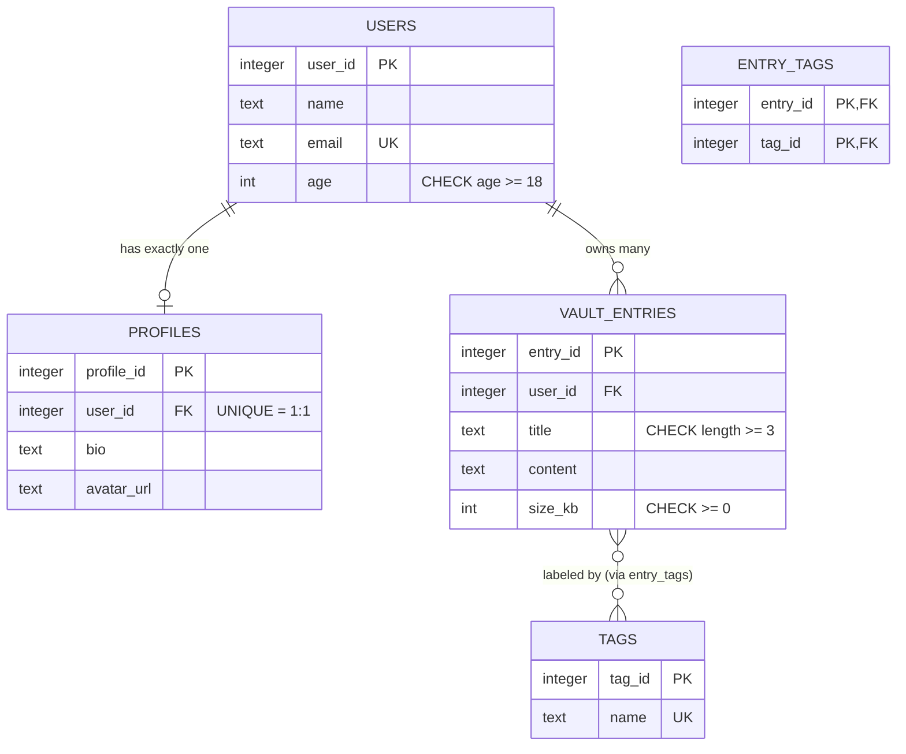

# Project 3: Database Integration — *Mastering the Architecture of State Persistence*

A **digital vault** API that stores documents with absolute reliability: every write is
validated, every relationship is enforced by the database itself, and every query is
parameterized against SQL injection.

> **Domain milestone:** Databases · CRUD · Data storage
> **Stack:** Node.js 24 + Express + `node:sqlite` (built-in driver) + SQLite

---

## 1. Project Idea & Chosen Stack

### Why this project
Project 2 kept data in an in-memory array — restart the server and everything vanishes.
This project replaces that array with a **real database** that survives restarts,
enforces rules on its own, and never trusts the app blindly.

### SQL vs NoSQL — which one and why

| | **SQL** (PostgreSQL, MySQL, SQLite) | **NoSQL** (MongoDB) |
|---|---|---|
| Structure | Fixed tables, rows, columns | Flexible documents, schema-less |
| Schema | Enforced (constraints, types) | Applied at read time (migrations) |
| Transactions | **ACID** — all-or-nothing | Weaker / eventual consistency |
| Relationships | First-class (JOINs, foreign keys) | Denormalized, embedded |
| Scale-up | Vertical (bigger machine) | Horizontal (more machines) |
| Best for | Money, inventory, accounts, **vaults** | Logs, feeds, rapidly changing shapes |

**Recommendation for this project: SQL (SQLite → portable to PostgreSQL).**

*Reasons:* a vault's entire value is **integrity** — no duplicate accounts, no orphaned
records, no lost writes. SQL gives us ACID transactions, foreign keys and CHECK
constraints *at the schema level*, so the guarantees hold even if app code has a bug.
NoSQL's flexible documents are an advantage when the data shape changes weekly —
not when a wrong row must be impossible.

### Native driver vs ORM — which one and why

| | **Native driver** (`node:sqlite`, `pg`) | **ORM** (Prisma, SQLAlchemy, Mongoose) |
|---|---|---|
| You write | Raw SQL | Query builder / model methods |
| Row mapping | Manual (driver does it here) | Automatic — rows become objects |
| Type-safety/autocomplete | In SQL, not in code | Strong (esp. Prisma) |
| Speed of development | Slower | Faster |
| Overhead | Minimal | Extra layer + learning curve |
| Best for | **Learning SQL, tight control** | Large teams, rapid iteration |

**Pick for this project: native driver.**
*Justification:* this milestone is *about* databases. An ORM would hide the SQL,
constraints and injection mechanics the project must demonstrate. The driver's
parameterized API is already type-safe-ish, zero-dependency, and — because SQLite is
built into Node 24 — nothing to install. When this graduates to PostgreSQL, the same
SQL swaps in behind the `pg` driver; the ORM decision comes later, deliberately.

---

## 2. Schema + ER Diagram

Full schema: [`src/db/schema.sql`](src/db/schema.sql) · seed: [`src/db/seed.sql`](src/db/seed.sql)

### Primary Keys & Foreign Keys, plainly

* **Primary Key (PK)** — a unique ID for every row (`user_id`, `entry_id`).
  No two rows share it; it never changes. It is *who the row is*.
* **Foreign Key (FK)** — a column pointing at another table's PK
  (`vault_entries.user_id` → `users.user_id`). It keeps **referential integrity**:
  you cannot file a document under a user who does not exist, and deleting the user
  can cascade-delete their documents.

```text
Users(UserID, Name, Email)  <----  Orders(OrderID, Total, UserID)
  PK ^                            FK --------^  (points to the PK)
```

### The three relationship types — worked examples

**① One-to-One: User → UserProfile**
One user has *at most one* profile; one profile belongs to exactly one user.
Enforced by putting `UNIQUE` on the FK:

```sql
CREATE TABLE profiles (
  profile_id INTEGER PRIMARY KEY,
  user_id    INTEGER NOT NULL UNIQUE,   -- UNIQUE makes it 1:1, not 1:N
  bio        TEXT,
  FOREIGN KEY (user_id) REFERENCES users (user_id) ON DELETE CASCADE
);
```
*Every* user still exists even without a profile → the read uses `LEFT JOIN`
(`src/routes/users.js`).

**② One-to-Many: Customer → Orders** *(here: User → Vault Entries)*
One user files many documents; each document has exactly one owner.

```sql
CREATE TABLE vault_entries (
  entry_id INTEGER PRIMARY KEY,
  user_id  INTEGER NOT NULL,               -- FK lives on the "many" side
  title    TEXT NOT NULL,
  FOREIGN KEY (user_id) REFERENCES users (user_id) ON DELETE CASCADE
);
```

**③ Many-to-Many: Students ↔ Courses, via Enrollments** *(here: Entries ↔ Tags)*
A document can have many tags; a tag can label many documents. Neither table can hold
the other's PK, so we add a **junction table** whose PK is the *pair*:

```sql
CREATE TABLE entry_tags (
  entry_id INTEGER NOT NULL,
  tag_id   INTEGER NOT NULL,
  PRIMARY KEY (entry_id, tag_id),          -- one link per pair, no duplicates
  FOREIGN KEY (entry_id) REFERENCES vault_entries (entry_id) ON DELETE CASCADE,
  FOREIGN KEY (tag_id)   REFERENCES tags (tag_id)            ON DELETE CASCADE
);
```

### ER Diagram



ASCII version:

```text
+------------+       1:1        +------------+
|   users    |----------------->|  profiles  |
| PK user_id |                  | PK profile |
| UQ email   |                  | FK user_id |
+------------+                  +------------+
      |
      | 1
      |                        N (junction)
      v                          ^
+----------------+   M:N   +-----+------+
| vault_entries  |-------->| entry_tags |------> +------+
| PK entry_id    |         | PK pair    |        | tags |
| FK user_id     |         +------------+        | PK   |
+----------------+                               +------+
```

### Full `CREATE TABLE` statements

See [`src/db/schema.sql`](src/db/schema.sql) — all five tables, constraints, FKs and
indexes in one file. Apply with `npm run db:migrate` (idempotent — safe to re-run).

---

## 3. Connection Code

File: [`src/db/connection.js`](src/db/connection.js)

```js
const { DatabaseSync } = require('node:sqlite');

function connect(dbPath = process.env.DB_PATH || './vault.db') {
  try {
    fs.mkdirSync(path.dirname(dbPath), { recursive: true });
    const db = new DatabaseSync(dbPath);
    db.exec('PRAGMA foreign_keys = ON');   // SQLite ships FKs OFF — turn them ON
    return db;
  } catch (err) {
    // PILLAR 2: catch, translate, re-throw with a clear message
    const wrapped = new Error(describeConnectionError(err, dbPath));
    wrapped.cause = err;
    throw wrapped;
  }
}
```

**Connection-error handling** — three layers:

1. `connect()` translates driver codes (`ENOTDIR`, `EACCES`, `SQLITE_BUSY`, …) into
   sentences a human can act on:
   `Invalid database path "Z:/…": the drive or folder does not exist.`
2. `src/server.js` wraps boot in `try/catch` and **fails fast** with
   `[boot] <message>` + `process.exit(1)` — no half-started server.
3. `GET /health` pings `SELECT 1` → `200 {database:"up"}` or `503 {database:"down"}`.

> **Note for production PostgreSQL:** the same shape holds — swap `node:sqlite` for
> `pg`'s `Pool`, use `$1` placeholders instead of `?`, and keep the try/catch
> translation. Relationship/constraint design carries over unchanged.

---

## 4. CRUD Endpoints with Test Examples

| CRUD | HTTP | SQL | Endpoint | Success |
|---|---|---|---|---|
| **C**reate | `POST` | `INSERT` | `/api/entries` | **201** |
| **R**ead | `GET` | `SELECT` | `/api/entries`, `/api/entries/:id` | **200** / 404 |
| **U**pdate (full) | `PUT` | `UPDATE` | `/api/entries/:id` | **200** / 404 |
| **U**pdate (partial) | `PATCH` | `UPDATE` | `/api/entries/:id` | **200** / 404 |
| **D**elete | `DELETE` | `DELETE` | `/api/entries/:id` | **204** / 404 |

Also: `/api/users` (GET/POST/DELETE — 1:1 profile + 1:N entries), `/health`.

**POST is non-idempotent:** sending the identical `POST` twice creates *two* rows —
that's correct semantics for "create" (and why `PUT` is preferred for idempotent
updates). This behavior is asserted in the test suite.

### Sample requests / responses

```bash
# CREATE -> 201
curl -X POST http://localhost:3000/api/entries \
  -H "Content-Type: application/json" \
  -d '{"user_id":1,"title":"Will & Testament","content":"pdf...","size_kb":2048}'
# 201 {"success":true,"data":{"entry_id":4,"title":"Will & Testament", ...}}

# READ -> 200
curl http://localhost:3000/api/entries/4
# 200 {"success":true,"data":{...,"owner":"Alice Johnson","tags":["identity"]}}

# UPDATE (full) -> 200
curl -X PUT http://localhost:3000/api/entries/4 \
  -H "Content-Type: application/json" \
  -d '{"user_id":1,"title":"Will & Testament v2","content":"updated","size_kb":3000}'

# UPDATE (partial) -> 200  (only size_kb changes)
curl -X PATCH http://localhost:3000/api/entries/4 \
  -H "Content-Type: application/json" -d '{"size_kb":10}'

# DELETE -> 204 (no body)
curl -X DELETE http://localhost:3000/api/entries/4

# Errors you should see:
# 404  GET/PUT/PATCH/DELETE of a missing id
# 400  {"errors":["title must be at least 3 characters"]}
# 409  duplicate email  |  foreign-key violation
```

### Run it

```bash
npm install
npm run db:migrate     # optional — schema also applies on boot
npm start              # http://localhost:3000
npm test               # 17 automated tests (node --test)
```

---

## 5. Constraints + SQL-Injection-Safe Code

### The database is the final source of truth

App validation gives friendly errors *first*; the schema guarantees correctness
*always*. Even a direct `sqlite3` shell or a bug in the app cannot violate these:

```sql
email      TEXT NOT NULL UNIQUE              -- no duplicate accounts
name       TEXT NOT NULL                     -- required fields
age        INTEGER NOT NULL CHECK (age >= 18)
title      TEXT NOT NULL CHECK (length(title) >= 3)
size_kb    INTEGER NOT NULL CHECK (size_kb >= 0)
user_id    INTEGER NOT NULL REFERENCES users(user_id) ON DELETE CASCADE
```

Proof from the test suite:

```text
✔ CHECK age >= 18 enforced at the SCHEMA level
✔ UNIQUE email enforced by the schema -> 409 via API
✔ FOREIGN KEY: entry with nonexistent user_id -> 409
✔ ON DELETE CASCADE: deleting a user removes profile + entries
```

### SQL injection — vulnerable vs secure

**Vulnerable (never do this):** input pasted into SQL *text*

```js
// input becomes CODE — the query structure changes
const sql = `SELECT * FROM users WHERE email = '${email}' AND password = '${pw}'`;
// email = "' OR 1=1 --"  produces:
// SELECT * FROM users WHERE email = '' OR 1=1 --' AND password = 'x'
//                                              ^^^^^^^^^^^^^^^^^^^^^^^^ commented out
// Result: every row returned → login bypassed, admin exposed.
```

**Secure fix — parameterized query (this codebase):**

```js
// ? placeholders: structure fixed at prepare time, values bound separately
db.prepare('SELECT * FROM users WHERE email = ? AND password = ?').all(email, pw);
```

**Same thing in PostgreSQL (`$1` style):**

```js
await pool.query('SELECT * FROM users WHERE email = $1 AND password = $2', [email, pw]);
//                                          ^^                  ^^
//                             placeholders;  [userInput] travels as DATA
```

**Why the input can never become code:** the driver sends *two separate things* to the
database engine — the SQL template (parsed once, structure frozen) and the values
(substituted afterwards, where only a value is grammatically allowed). `' OR 1=1 --`
arrives as a literal string that no row's email equals → 0 rows, table untouched.

**Run the live proof:**

```bash
npm run demo:injection
#  concat version : 2 rows  <- LOGIN BYPASSED
#  parameterized  : 0 rows  <- payload treated as data, table intact
```

---

## 6. Final Quality Checklist

- [x] **Schema designed & documented** — 5 tables, ER diagram, PK/FK explained
- [x] **All 3 relationship types** — 1:1 (`profiles`), 1:N (`vault_entries`),
      M:N (`entry_tags` junction) — implemented *and* exercised by tests
- [x] **Full CRUD** — POST/GET/PUT/PATCH/DELETE with correct status codes
      (201/200/204, 400/404/409/503)
- [x] **Data integrity at schema level** — NOT NULL, UNIQUE, CHECK, FK, CASCADE
      (proven by tests, not just app logic)
- [x] **Connection error handling** — fail-fast boot, translated messages, `/health`
- [x] **SQL injection safe** — 100% parameterized queries + runnable demo proving it
- [x] **Automated tests** — `npm test` → **17/17 passing**
- [x] **Experiment: index optimization** — `npm run demo:index` →
      `SCAN` → `USING INDEX`, **16.6x faster** (2770ms → 167ms / 2000 queries)
- [x] **Portfolio-ready** — README, clean folder structure, setup steps, `.gitignore`

### Folder structure

```text
project3/
├── README.md
├── package.json
├── src/
│   ├── server.js              # boot: connect → fail fast → listen
│   ├── app.js                 # express wiring + /health + error handler
│   ├── db/
│   │   ├── schema.sql         # PILLAR 1: CREATE TABLE statements
│   │   ├── seed.sql           # demo data (INSERT OR IGNORE)
│   │   ├── connection.js      # PILLAR 2: connect + error translation
│   │   └── migrate.js         # idempotent migration runner
│   ├── routes/
│   │   ├── entries.js         # PILLAR 3: full CRUD on vault entries
│   │   └── users.js           # 1:1 profile + 1:N entries + transactions
│   └── middleware/
│       └── validate.js        # PILLAR 4: validation + DB error → HTTP mapping
├── scripts/
│   ├── sql-injection-demo.js  # PILLAR 4: vulnerable vs secure, side by side
│   └── index-benchmark.js     # EXPERIMENT: index optimization
└── tests/
    └── api.test.js            # 17 tests covering all four pillars
```

### Troubleshooting

| Symptom | Fix |
|---|---|
| `Schema missing — run "npm run db:migrate"` | `npm run db:migrate` |
| `Database … is locked` | Another process holds the file — stop it |
| `drive or folder does not exist` | Bad `DB_PATH` — use a valid path |
| Want a fresh DB | Delete `vault.db`, restart (schema + seed rebuild) |
